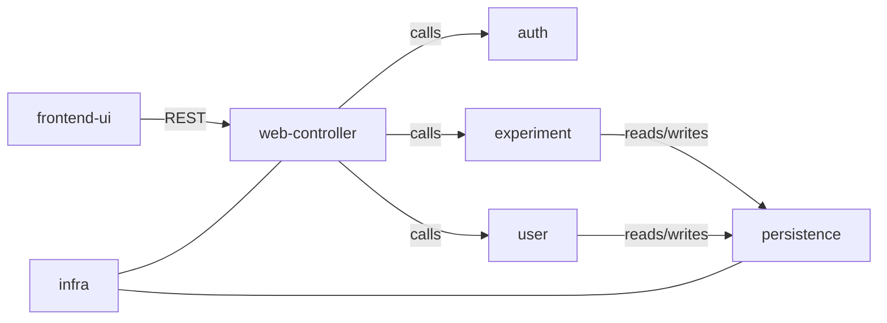

# CampusHub 架构设计文档 (Phase 2)

## 1. 架构概览
### 1.1 架构风格：模块化单体 (Modular Monolith)
本项目放弃了微服务方案，采用**模块化单体架构**。系统在物理上作为一个整体进程部署，但在逻辑代码层面按照业务领域进行严格的分包隔离（Package-by-Feature）。

**核心决策理由：**
*   **交付确定性**：避开分布式事务和服务发现等复杂基建，确保 10 周内交付。
*   **团队匹配度**：契合学生团队现有的 Java 技术栈，降低运维与联调成本。
*   **演进性**：逻辑模块化为未来平滑拆分为微服务留下了清晰边界。

### 1.2 架构逻辑图
系统划分为前端 UI、Web 控制层、业务核心层及基础设施层。

*(参考文件: module-dependency.mmd / module-dependency.png)*

---

## 2. 模块划分说明
系统划分为以下 7 个核心模块，严格遵循“跨业务域严禁跨层调用”的防腐规范。

| 模块名称 | 职责边界 |
| :--- | :--- |
| **frontend-ui** | 负责用户界面、路由及页面状态；通过 REST API 与后端通信。 |
| **web-controller** | 后端入口层，负责请求路由、参数校验及鉴权校验（调用 auth）。 |
| **auth** | 负责用户认证与授权（JWT 签发/验证、登录、黑名单管理）。 |
| **user** | 负责用户 CRUD、资料维护及权限数据的持久化。 |
| **experiment** | 核心业务域，负责实验/题库的创建、分发、提交与评分。 |
| **persistence** | 统一数据访问层，封装 Repository/DAO，禁止业务逻辑渗入。 |
| **infra** | 横切基础设施（日志、全局异常处理、工具类、健康检查）。 |

**开发红线规范：** 任何模块间的跨域交互必须通过对方模块的 `Service` 层公开接口进行，**严禁直接调用其他模块的 Repository**。

---

## 3. 技术选型说明
基于团队成员经验与 10 周工期的工程约束，选定以下技术栈：

| 层次 | 选型方案 | 理由 |
| :--- | :--- | :--- |
| **前端框架** | **Vue 3 + JavaScript** | 放弃 TypeScript 以降低学习成本，提升初期联调效率。 |
| **后端框架** | **Spring Boot 3 (Java 17)** | 生态丰富，契合团队现有 Java 技术基础。 |
| **数据库** | **H2 (Dev) / MySQL 8.x (Prod)** | H2 便于测试，MySQL 保证生产环境数据持久化。 |
| **认证机制** | **JWT (无状态)** | 契合前后端分离架构，降低服务端内存开销。 |
| **API 文档** | **Swagger / Knife4j** | 代码即文档，实现前后端“契约先行”的并行开发。 |
| **部署方式** | **Docker Compose** | 统一本地与服务器环境，解决“环境不一致”问题。 |

---

## 4. 架构决策记录 (ADR) 集合

### ADR-001：采用模块化单体架构
*   **决策**：放弃微服务，采用逻辑分包隔离的单体架构。
*   **后果**：开发流程极简，性能高；但需预防模块间强耦合产生“面条代码”。
*   **AI 协作**：AI 曾强烈建议微服务，人工修订根据“10周工期”约束予以拒绝。

### ADR-002：前端开发语言选择纯 JavaScript
*   **决策**：不引入 TypeScript。
*   **理由**：抢占开发时间，避免团队成员因复杂类型报错卡住进度。
*   **后果**：需通过完善的 API 文档和 Code Review 弥补类型检查的缺失。

### ADR-003：严禁跨模块直接调用 Repository
*   **决策**：跨域交互必须走 Service 接口。
*   **后果**：保证模块独立性，表结构变更不级联报错；但增加了少量模板代码。

### ADR-004：采用 JWT 实现无状态鉴权
*   **决策**：弃用 Session-Cookie，采用 JWT。
*   **理由**：天然避开 CSRF 攻击，复用度高。
*   **风险**：需合理设置过期时间，且不能在 Payload 存放敏感信息。

### ADR-005：建立统一的 API 响应格式与全局异常处理
*   **决策**：固定返回 `{code, message, data}`，使用 `@ControllerAdvice` 拦截异常。
*   **修订**：放弃纯 HTTP 状态码，改用 HTTP 200 + 业务自定义 Code（如 20000）。

### ADR-006：使用 Swagger/Knife4j 作为前后端契约基准
*   **决策**：集成 Swagger，要求“契约先行”，先定义接口再写业务逻辑。
*   **理由**：文档与代码实时同步，彻底消灭文档过时问题。

### ADR-007：采用 Docker Compose 统一环境
*   **决策**：使用 `docker-compose.yml` 编排数据库、Redis 及后端应用。
*   **修订**：砍掉 AI 推荐的 K8s 方案，降级为最极简的单机编排以减轻运维负担。