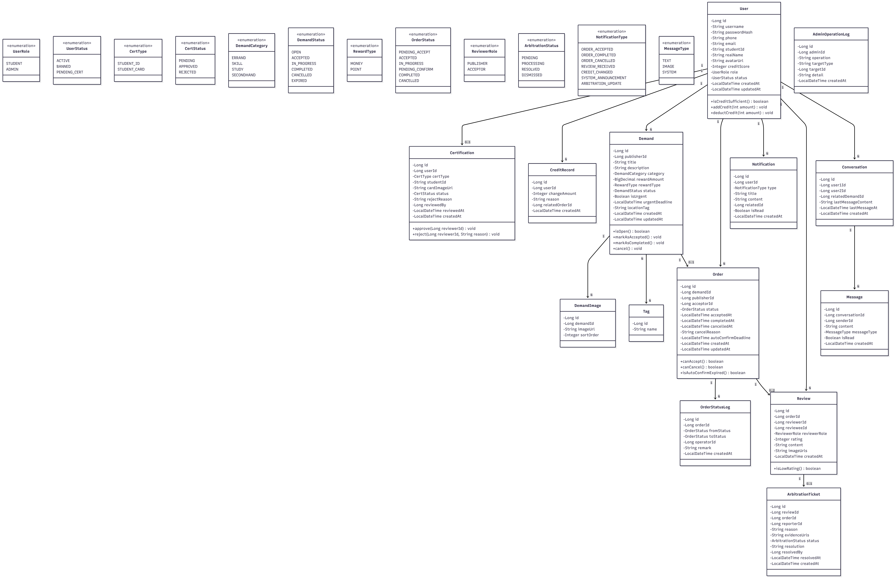
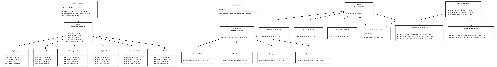
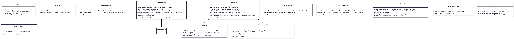
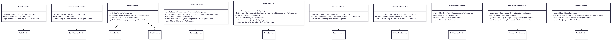

# CampusHub 核心类图设计（Phase 3 任务 1）

## 1. 设计概述

本次类图设计覆盖系统全部功能模块（P0 / P1 / P2），遵循 P2 阶段确定的模块化单体架构（Vue 3 + Spring Boot 3），按 Controller → Service → Repository → Entity 四层展开。

类图按视角拆分为四张，分别聚焦：

| 图编号 | 视角 | 文件 |
|---|---|---|
| 图 1 | 核心实体与关系 | `images/class-diagram-entities.png` |
| 图 2 | 设计模式（策略 / 工厂 / 观察者 / 匹配器） | `images/class-diagram-patterns.png` |
| 图 3 | Service 层 | `images/class-diagram-services.png` |
| 图 4 | Controller 层 | `images/class-diagram-controllers.png` |

---

## 2. 核心实体关系图

### 2.1 枚举类定义

#### UserRole
| 枚举值 | 说明 |
|---|---|
| STUDENT | 普通学生用户 |
| ADMIN | 管理员 |

#### UserStatus
| 枚举值 | 说明 |
|---|---|
| ACTIVE | 正常状态 |
| BANNED | 封禁 |
| PENDING_CERT | 待实名认证 |

#### CertType
| 枚举值 | 说明 |
|---|---|
| STUDENT_ID | 教务处学号认证 |
| STUDENT_CARD | 学生证照片认证 |

#### CertStatus
| 枚举值 | 说明 |
|---|---|
| PENDING | 待审核 |
| APPROVED | 已通过 |
| REJECTED | 已驳回 |

#### DemandCategory
| 枚举值 | 说明 |
|---|---|
| ERRAND | 跑腿代办（快递/外卖） |
| SKILL | 技能求助（装软件/修电脑） |
| STUDY | 学习互助（考研占座/资料分享） |
| SECONDHAND | 二手闲置 |

#### DemandStatus
| 枚举值 | 说明 |
|---|---|
| OPEN | 开放中，可被接单 |
| ACCEPTED | 已被接单 |
| IN_PROGRESS | 进行中 |
| COMPLETED | 已完成 |
| CANCELLED | 已取消 |
| EXPIRED | 已过期 |

#### RewardType
| 枚举值 | 说明 |
|---|---|
| MONEY | 现金报酬 |
| POINT | 积分报酬 |

#### OrderStatus
| 枚举值 | 说明 |
|---|---|
| PENDING_ACCEPT | 待接单 |
| ACCEPTED | 已接单 |
| IN_PROGRESS | 进行中 |
| PENDING_CONFIRM | 待确认（服务方已标记完成，等待需求方确认） |
| COMPLETED | 已完成 |
| CANCELLED | 已取消 |

#### ReviewerRole
| 枚举值 | 说明 |
|---|---|
| PUBLISHER | 需求方发起评价 |
| ACCEPTOR | 服务方发起评价 |

#### ArbitrationStatus
| 枚举值 | 说明 |
|---|---|
| PENDING | 待处理 |
| PROCESSING | 处理中 |
| RESOLVED | 已解决 |
| DISMISSED | 已驳回 |

#### NotificationType
| 枚举值 | 说明 |
|---|---|
| ORDER_ACCEPTED | 需求已被接单 |
| ORDER_COMPLETED | 订单已完成 |
| ORDER_CANCELLED | 订单已取消 |
| REVIEW_RECEIVED | 收到新评价 |
| CREDIT_CHANGED | 信用分变动 |
| SYSTEM_ANNOUNCEMENT | 系统公告 |
| ARBITRATION_UPDATE | 仲裁进展 |

#### MessageType
| 枚举值 | 说明 |
|---|---|
| TEXT | 文本消息 |
| IMAGE | 图片消息 |
| SYSTEM | 系统消息 |

---

### 2.2 实体类详细定义

#### User（用户）

**属性：**

| 属性名 | 类型 | 说明 |
|---|---|---|
| id | Long | 主键，自增 |
| username | String | 唯一登录名 |
| passwordHash | String | BCrypt 加密存储 |
| phone | String | 加密存储，接单后对服务方脱敏展示 |
| email | String | 可选 |
| studentId | String | 学号，唯一，用于实名认证 |
| realName | String | 真实姓名 |
| avatarUrl | String | 头像地址 |
| creditScore | Integer | 信用分，初始 100 |
| role | UserRole | 用户角色（STUDENT / ADMIN） |
| status | UserStatus | 账号状态 |
| createdAt | LocalDateTime | 创建时间 |
| updatedAt | LocalDateTime | 最后更新时间 |

**方法：**

| 方法名 | 参数 | 返回值 | 说明 |
|---|---|---|---|
| isCreditSufficient | — | boolean | 判断信用分是否 ≥ 60（低于 60 限制接单） |
| addCredit | int amount | void | 增加信用分 |
| deductCredit | int amount | void | 扣减信用分 |

---

#### Certification（实名认证）

**属性：**

| 属性名 | 类型 | 说明 |
|---|---|---|
| id | Long | 主键 |
| userId | Long | 外键 → User |
| certType | CertType | 认证类型（学号 / 学生证） |
| studentId | String | 学号信息 |
| cardImageUrl | String | 学生证图片地址 |
| status | CertStatus | 审核状态 |
| rejectReason | String | 驳回原因 |
| reviewedBy | Long | 审核人 ID |
| reviewedAt | LocalDateTime | 审核时间 |
| createdAt | LocalDateTime | 提交时间 |

**方法：**

| 方法名 | 参数 | 返回值 | 说明 |
|---|---|---|---|
| approve | Long reviewerId | void | 审核通过 |
| reject | Long reviewerId, String reason | void | 驳回并填写原因 |

---

#### CreditRecord（信用变动记录）

**属性：**

| 属性名 | 类型 | 说明 |
|---|---|---|
| id | Long | 主键 |
| userId | Long | 外键 → User |
| changeAmount | Integer | 变动金额（正数加分，负数扣分） |
| reason | String | 变动原因（如"完成订单加分""违约扣分"） |
| relatedOrderId | Long | 关联订单 ID（可空） |
| createdAt | LocalDateTime | 变动时间 |

---

#### Demand（需求/发单）

**属性：**

| 属性名 | 类型 | 说明 |
|---|---|---|
| id | Long | 主键 |
| publisherId | Long | 外键 → User（需求方） |
| title | String | 需求标题 |
| description | String | 详细描述 |
| category | DemandCategory | 需求板块（跑腿/技能/学习/二手） |
| rewardAmount | BigDecimal | 报酬金额 |
| rewardType | RewardType | 报酬类型（现金/积分） |
| status | DemandStatus | 需求状态 |
| isUrgent | Boolean | 是否加急 |
| urgentDeadline | LocalDateTime | 加急截止时间（isUrgent = true 时有值） |
| locationTag | String | 位置标签（南区快递点、一教、图书馆等） |
| createdAt | LocalDateTime | 发布时间 |
| updatedAt | LocalDateTime | 最后更新时间 |

**方法：**

| 方法名 | 参数 | 返回值 | 说明 |
|---|---|---|---|
| isOpen | — | boolean | 是否处于开放状态（可被接单） |
| markAsAccepted | — | void | 标记为已被接单 |
| markAsCompleted | — | void | 标记为已完成 |
| cancel | — | void | 取消需求 |

---

#### DemandImage（需求图片）

**属性：**

| 属性名 | 类型 | 说明 |
|---|---|---|
| id | Long | 主键 |
| demandId | Long | 外键 → Demand |
| imageUrl | String | 图片地址 |
| sortOrder | Integer | 排序序号 |

---

#### Tag（标签）

**属性：**

| 属性名 | 类型 | 说明 |
|---|---|---|
| id | Long | 主键 |
| name | String | 标签名（如"南区快递点""图书馆"） |

**关联：** 与 Demand 为多对多关系，通过 `demand_tags` 中间表关联。

---

#### Order（订单）

**属性：**

| 属性名 | 类型 | 说明 |
|---|---|---|
| id | Long | 主键 |
| demandId | Long | 外键 → Demand，唯一约束（一个需求最多一个订单） |
| publisherId | Long | 外键 → User（需求方） |
| acceptorId | Long | 外键 → User（服务方） |
| status | OrderStatus | 订单状态 |
| acceptedAt | LocalDateTime | 接单时间 |
| completedAt | LocalDateTime | 完成时间 |
| cancelledAt | LocalDateTime | 取消时间 |
| cancelReason | String | 取消原因 |
| autoConfirmDeadline | LocalDateTime | 自动验收截止时间（接单后 +24h） |
| createdAt | LocalDateTime | 创建时间 |
| updatedAt | LocalDateTime | 最后更新时间 |

**方法：**

| 方法名 | 参数 | 返回值 | 说明 |
|---|---|---|---|
| canAccept | — | boolean | 当前状态是否允许接单 |
| canCancel | — | boolean | 当前状态是否允许取消 |
| isAutoConfirmExpired | — | boolean | 是否超过 24 小时自动验收期限 |

---

#### OrderStatusLog（订单状态变更日志）

**属性：**

| 属性名 | 类型 | 说明 |
|---|---|---|
| id | Long | 主键 |
| orderId | Long | 外键 → Order |
| fromStatus | OrderStatus | 变更前状态 |
| toStatus | OrderStatus | 变更后状态 |
| operatorId | Long | 操作人 ID |
| remark | String | 备注 |
| createdAt | LocalDateTime | 变更时间 |

---

#### Review（评价）

**属性：**

| 属性名 | 类型 | 说明 |
|---|---|---|
| id | Long | 主键 |
| orderId | Long | 外键 → Order，唯一约束 |
| reviewerId | Long | 评价人 ID |
| revieweeId | Long | 被评价人 ID |
| reviewerRole | ReviewerRole | 评价人身份（需求方/服务方） |
| rating | Integer | 评分 1-5 星 |
| content | String | 评价内容（3 星及以下必填 ≥ 15 字） |
| imageUrls | String | JSON 数组存储截图 URL |
| createdAt | LocalDateTime | 评价时间 |

**方法：**

| 方法名 | 参数 | 返回值 | 说明 |
|---|---|---|---|
| isLowRating | — | boolean | 是否为低分评价（rating ≤ 3） |

---

#### ArbitrationTicket（仲裁工单）

**属性：**

| 属性名 | 类型 | 说明 |
|---|---|---|
| id | Long | 主键 |
| reviewId | Long | 外键 → Review |
| orderId | Long | 外键 → Order |
| reporterId | Long | 举报人 ID |
| reason | String | 仲裁原因 |
| evidenceUrls | String | 证据图片 JSON |
| status | ArbitrationStatus | 工单状态 |
| resolution | String | 处理结果 |
| resolvedBy | Long | 处理人 ID（管理员） |
| resolvedAt | LocalDateTime | 处理时间 |
| createdAt | LocalDateTime | 创建时间 |

---

#### Notification（站内通知）

**属性：**

| 属性名 | 类型 | 说明 |
|---|---|---|
| id | Long | 主键 |
| userId | Long | 接收人 ID |
| type | NotificationType | 通知类型 |
| title | String | 通知标题 |
| content | String | 通知内容 |
| relatedId | Long | 关联业务 ID（订单/需求） |
| isRead | Boolean | 是否已读，默认 false |
| createdAt | LocalDateTime | 创建时间 |

---

#### Conversation（会话）

**属性：**

| 属性名 | 类型 | 说明 |
|---|---|---|
| id | Long | 主键 |
| user1Id | Long | 参与者 1 ID |
| user2Id | Long | 参与者 2 ID |
| relatedDemandId | Long | 关联需求 ID（可空） |
| lastMessageContent | String | 最新消息摘要（冗余字段，方便列表展示） |
| lastMessageAt | LocalDateTime | 最新消息时间 |
| createdAt | LocalDateTime | 创建时间 |

**唯一约束：** (user1Id, user2Id, relatedDemandId)

---

#### Message（消息）

**属性：**

| 属性名 | 类型 | 说明 |
|---|---|---|
| id | Long | 主键 |
| conversationId | Long | 外键 → Conversation |
| senderId | Long | 发送人 ID |
| content | String | 消息内容 |
| messageType | MessageType | 消息类型（文本/图片/系统） |
| isRead | Boolean | 是否已读，默认 false |
| createdAt | LocalDateTime | 发送时间 |

---

#### AdminOperationLog（管理员操作日志）

**属性：**

| 属性名 | 类型 | 说明 |
|---|---|---|
| id | Long | 主键 |
| adminId | Long | 操作管理员 ID |
| operation | String | 操作类型 |
| targetType | String | 操作对象类型 |
| targetId | Long | 操作对象 ID |
| detail | String | 操作详情 |
| createdAt | LocalDateTime | 操作时间 |

---

### 2.3 实体关系汇总表

| 类 A | 关系类型 | 类 B | 基数 | 说明 |
|---|---|---|---|---|
| User | 组合 | Certification | 1:0..1 | 用户拥有 0 或 1 个认证记录 |
| User | 组合 | CreditRecord | 1:N | 用户拥有多条信用变动记录 |
| User | 聚合 | Demand | 1:N | 用户发布多个需求 |
| User | 聚合 | Order（publisher） | 1:N | 作为需求方的订单 |
| User | 聚合 | Order（acceptor） | 1:N | 作为服务方的订单 |
| User | 组合 | Notification | 1:N | 用户接收多条站内通知 |
| User | 聚合 | Review（reviewer） | 1:N | 用户发出的评价 |
| User | 聚合 | Review（reviewee） | 1:N | 用户收到的评价 |
| User | 聚合 | Conversation | 1:N | 用户参与的会话 |
| Demand | 组合 | DemandImage | 1:N | 需求包含多张图片 |
| Demand | 多对多 | Tag | N:M | 需求与校园标签关联 |
| Demand | 组合 | Order | 1:0..1 | 一个需求最多对应一个订单 |
| Order | 组合 | OrderStatusLog | 1:N | 订单包含多条状态变更日志 |
| Order | 组合 | Review | 1:0..2 | 一个订单最多产生 2 条评价（双方各一条） |
| Review | 聚合 | ArbitrationTicket | 1:0..1 | 低分评价自动生成 0 或 1 个仲裁工单 |
| Conversation | 组合 | Message | 1:N | 会话包含多条消息 |

---

## 3. 设计模式类图

### 3.1 策略模式（Strategy）— 订单状态管理

**问题**：订单有 6 种状态（PENDING_ACCEPT → ACCEPTED → IN_PROGRESS → PENDING_CONFIRM → COMPLETED / CANCELLED），每种状态下可执行的操作不同。如果用 if-else 判断，OrderService 的每个方法都要重复一遍状态分支，新增状态时所有方法都要改。

**方案**：定义 `IOrderStateStrategy` 接口，6 个状态各有一个实现类。`OrderStateContext` 持有当前策略，运行时根据订单状态自动选择对应策略。

#### IOrderStateStrategy（策略接口）

**方法：**

| 方法名 | 参数 | 返回值 | 说明 |
|---|---|---|---|
| canAccept | — | boolean | 当前状态是否允许接单 |
| canComplete | — | boolean | 当前状态是否允许标记完成 |
| canCancel | — | boolean | 当前状态是否允许取消 |
| canConfirm | — | boolean | 当前状态是否允许确认验收 |
| getValidTransitions | — | List\<OrderStatus\> | 返回当前状态可转移到的目标状态列表 |

#### OrderStateContext（上下文）

**属性：**

| 属性名 | 类型 | 说明 |
|---|---|---|
| strategy | IOrderStateStrategy | 当前持有的策略实例 |

**方法：**

| 方法名 | 参数 | 返回值 | 说明 |
|---|---|---|---|
| setStrategy | OrderStatus status | void | 根据当前状态设置对应策略 |
| canTransition | OrderStatus target | boolean | 判断是否可转移到目标状态 |
| getValidTransitions | — | List\<OrderStatus\> | 获取当前可执行的操作列表 |

#### 6 个状态实现类

| 实现类 | canAccept | canComplete | canCancel | canConfirm | 有效转移目标 |
|---|---|---|---|---|---|
| PendingAcceptState | ✅ | ❌ | ✅(无责) | ❌ | ACCEPTED, CANCELLED |
| AcceptedState | ❌ | ❌ | ✅(10min内无责/超时扣分) | ❌ | IN_PROGRESS, CANCELLED |
| InProgressState | ❌ | ✅ | ✅(扣分) | ❌ | PENDING_CONFIRM, CANCELLED |
| PendingConfirmState | ❌ | ❌ | ❌ | ✅ | COMPLETED |
| CompletedState | ❌ | ❌ | ❌ | ❌ | 无（终态） |
| CancelledState | ❌ | ❌ | ❌ | ❌ | 无（终态） |

---

### 3.2 工厂模式（Factory）— 需求创建

**问题**：四大需求板块创建时有不同的校验规则。如果在 DemandService 里用 switch 判断 category，新增板块就要改创建方法。

**方案**：定义 `DemandValidator` 接口，每种板块一个校验实现类。`DemandFactory` 根据 category 从 Map 取出对应 Validator 执行校验后再创建实体。

#### DemandFactory（工厂）

**属性：**

| 属性名 | 类型 | 说明 |
|---|---|---|
| validators | Map\<DemandCategory, DemandValidator\> | 板块到校验器的映射 |

**方法：**

| 方法名 | 参数 | 返回值 | 说明 |
|---|---|---|---|
| createDemand | DemandCreateDto dto | Demand | 根据 category 选择 Validator 校验后创建 Demand 实体 |

#### DemandValidator（校验接口）

**方法：**

| 方法名 | 参数 | 返回值 | 说明 |
|---|---|---|---|
| validate | DemandCreateDto dto | void | 校验该板块特有的必填字段 |

#### 4 个校验实现类

| 实现类 | 板块 | 校验规则 |
|---|---|---|
| ErrandValidator | 跑腿代办 | 必须填写取件地址和送达地址 |
| SkillValidator | 技能求助 | 必须填写技能类型标签 |
| StudyValidator | 学习互助 | 必须关联时间段（如占座时间） |
| SecondhandValidator | 二手闲置 | 必须上传实物图片，需指定议价/一口价模式 |

---

### 3.3 观察者模式（Observer）— 订单事件通知

**问题**：订单状态变更时需要触发通知发送、信用分变动、需求状态更新等多个副作用。如果全部写在 OrderService 里，职责过多且每新增副作用就要改 OrderService。

**方案**：利用 Spring 的 ApplicationEventPublisher，OrderService 只负责发布事件，各监听器独立处理各自的副作用。

#### OrderEventPublisher（事件发布器）

**方法：**

| 方法名 | 参数 | 返回值 | 说明 |
|---|---|---|---|
| publishAccepted | Long orderId | void | 发布"订单已被接单"事件 |
| publishCompleted | Long orderId | void | 发布"订单已完成"事件 |
| publishCancelled | Long orderId | void | 发布"订单已取消"事件 |

#### OrderNotificationListener（通知监听器）

**方法：**

| 方法名 | 参数 | 返回值 | 说明 |
|---|---|---|---|
| onOrderAccepted | OrderAcceptedEvent event | void | → 发送通知给需求方 |
| onOrderCompleted | OrderCompletedEvent event | void | → 发送通知给双方 |
| onOrderCancelled | OrderCancelledEvent event | void | → 发送通知给对方 |

#### CreditUpdateListener（信用分监听器）

**方法：**

| 方法名 | 参数 | 返回值 | 说明 |
|---|---|---|---|
| onOrderCompleted | OrderCompletedEvent event | void | → 服务方信用加分 |
| onOrderCancelled | OrderCancelledEvent event | void | → 违约方信用扣分 |

---

### 3.4 策略模式（Strategy）— 智能匹配（P2）

**问题**：为需求匹配服务方有多种策略（按位置、按技能、按信用分），且可能组合使用。

**方案**：定义 `DemandMatcher` 接口，各匹配策略独立实现，`CompositeMatcher` 组合多个 matcher 做加权排序。

#### DemandMatcher（匹配接口）

**方法：**

| 方法名 | 参数 | 返回值 | 说明 |
|---|---|---|---|
| match | Demand demand | List\<UserRecommendation\> | 为需求匹配合适的服务方列表 |

#### 4 个匹配实现类

| 实现类 | 匹配逻辑 |
|---|---|
| LocationBasedMatcher | 按地理位置标签（南区快递点等）匹配就近用户 |
| SkillBasedMatcher | 按需求技能标签匹配具备对应技能的用户 |
| CreditBasedMatcher | 按信用分排序推荐高信用用户 |
| CompositeMatcher | 组合上述多个 matcher，加权综合排序 |

#### CompositeMatcher（组合匹配器）

**属性：**

| 属性名 | 类型 | 说明 |
|---|---|---|
| matchers | List\<DemandMatcher\> | 被组合的多个匹配器 |

---

## 4. Service 层类图

### 4.1 auth 模块

#### AuthService

**方法：**

| 方法名 | 参数 | 返回值 | 说明 |
|---|---|---|---|
| register | UserRegisterDto dto | UserDto | 用户注册（含学号唯一性校验） |
| login | String username, String password | TokenDto | 用户登录，返回 JWT |
| logout | String token | void | 用户登出（Token 加入黑名单） |
| validateToken | String token | boolean | 校验 Token 有效性 |

**依赖：** JwtTokenProvider

#### JwtTokenProvider

**方法：**

| 方法名 | 参数 | 返回值 | 说明 |
|---|---|---|---|
| generateToken | Long userId, String username | String | 签发 JWT |
| getUserIdFromToken | String token | Long | 从 Token 解析 userId |
| isTokenValid | String token | boolean | 校验 Token 过期和签名 |

---

### 4.2 user 模块

#### UserService

**方法：**

| 方法名 | 参数 | 返回值 | 说明 |
|---|---|---|---|
| getUserById | Long userId | UserDto | 获取用户完整信息 |
| updateProfile | Long userId, UserUpdateDto dto | UserDto | 更新个人资料 |
| getUserPublicInfo | Long userId | UserPublicDto | 获取用户公开信息（脱敏） |

#### CertificationService

**方法：**

| 方法名 | 参数 | 返回值 | 说明 |
|---|---|---|---|
| submit | Long userId, CertSubmitDto dto | CertificationDto | 提交实名认证申请 |
| review | Long certId, Long adminId, boolean approve, String reason | CertificationDto | 管理员审核认证 |
| getByUserId | Long userId | CertificationDto | 查询用户认证状态 |

#### CreditService

**方法：**

| 方法名 | 参数 | 返回值 | 说明 |
|---|---|---|---|
| addCredit | Long userId, int amount, String reason, Long orderId | void | 增加信用分并记录变动 |
| deductCredit | Long userId, int amount, String reason, Long orderId | void | 扣减信用分并记录变动 |
| canAcceptOrder | Long userId | boolean | 判断用户信用分是否满足接单条件（≥60） |
| getRecords | Long userId, Pageable pageable | Page\<CreditRecordDto\> | 查询信用变动历史 |

---

### 4.3 experiment（核心业务）模块

#### DemandService

**方法：**

| 方法名 | 参数 | 返回值 | 说明 |
|---|---|---|---|
| createDemand | Long userId, DemandCreateDto dto | DemandDto | 发布需求（通过 DemandFactory 创建） |
| getDemandDetail | Long demandId | DemandDto | 获取需求详情 |
| listDemands | DemandFilterDto filter, Pageable pageable | Page\<DemandDto\> | 需求列表（含筛选、搜索、分页） |
| updateDemand | Long demandId, Long userId, DemandUpdateDto dto | DemandDto | 编辑需求 |
| cancelDemand | Long demandId, Long userId | void | 取消需求 |
| expireUrgentDemands | — | void | 定时任务：过期加急需求 |
| searchByKeyword | String keyword, Pageable pageable | Page\<DemandDto\> | 关键词搜索需求 |

**依赖：** DemandFactory

#### OrderService

**方法：**

| 方法名 | 参数 | 返回值 | 说明 |
|---|---|---|---|
| acceptOrder | Long userId, Long demandId | OrderDto | 接单（校验信用分、防并发锁） |
| markDelivered | Long orderId, Long userId | OrderDto | 服务方标记已送达/已完成 |
| confirmCompletion | Long orderId, Long userId | OrderDto | 需求方确认验收 |
| requestCancel | Long orderId, Long userId, String reason | OrderDto | 申请取消（10分钟内无责 / 超时扣信用分） |
| getOrderDetail | Long orderId, Long userId | OrderDto | 订单详情 |
| listMyOrders | Long userId, String role, OrderStatus status, Pageable pageable | Page\<OrderDto\> | 我的订单列表（支持按角色/状态筛选） |
| autoConfirmExpired | — | void | 定时任务：超过 24 小时未确认自动验收 |

**依赖：** CreditService、NotificationService、OrderStateContext、OrderEventPublisher

#### ReviewService

**方法：**

| 方法名 | 参数 | 返回值 | 说明 |
|---|---|---|---|
| submitReview | Long orderId, Long reviewerId, ReviewCreateDto dto | ReviewDto | 提交评价（3 星及以下强制 ≥ 15 字 + 截图） |
| getReviewsForUser | Long userId, Pageable pageable | Page\<ReviewDto\> | 查看某用户收到的评价 |
| getMyReview | Long orderId, Long userId | ReviewDto | 查看我对某订单的评价 |

#### ArbitrationService

**方法：**

| 方法名 | 参数 | 返回值 | 说明 |
|---|---|---|---|
| createTicket | Long reviewId, ArbitrationCreateDto dto | ArbitrationTicketDto | 创建仲裁工单（低分评价自动生成） |
| resolveTicket | Long ticketId, Long adminId, String resolution | ArbitrationTicketDto | 管理员处理仲裁 |
| listPendingTickets | Pageable pageable | Page\<ArbitrationTicketDto\> | 待处理工单列表 |

---

### 4.4 通知域

#### NotificationService

**方法：**

| 方法名 | 参数 | 返回值 | 说明 |
|---|---|---|---|
| sendNotification | Long userId, NotificationType type, String title, String content, Long relatedId | void | 创建并存储通知 |
| getNotifications | Long userId, Pageable pageable | Page\<NotificationDto\> | 获取通知列表 |
| markAsRead | Long notificationId, Long userId | void | 标记单条已读 |
| markAllAsRead | Long userId | void | 全部标记已读 |
| getUnreadCount | Long userId | Long | 获取未读数量 |

---

### 4.5 即时通讯（P2）

#### ConversationService

**方法：**

| 方法名 | 参数 | 返回值 | 说明 |
|---|---|---|---|
| getOrCreate | Long user1Id, Long user2Id, Long demandId | ConversationDto | 获取已有会话或新建 |
| sendMessage | Long conversationId, Long senderId, MessageCreateDto dto | MessageDto | 发送消息 |
| getConversations | Long userId | List\<ConversationDto\> | 获取用户会话列表 |
| getMessages | Long conversationId, Long userId, Pageable pageable | Page\<MessageDto\> | 获取历史消息 |
| markAsRead | Long conversationId, Long userId | void | 标记会话已读 |

---

### 4.6 智能匹配与推荐（P2）

#### RecommendationService

**方法：**

| 方法名 | 参数 | 返回值 | 说明 |
|---|---|---|---|
| recommendDemands | Long userId, Pageable pageable | Page\<DemandDto\> | 为用户推荐感兴趣的需求 |
| recommendUsers | Long demandId | List\<UserRecommendation\> | 为需求推荐合适的服务方 |

---

### 4.7 管理后台（P2）

#### AdminService

**方法：**

| 方法名 | 参数 | 返回值 | 说明 |
|---|---|---|---|
| getDashboardStats | — | DashboardStatsDto | 获取数据看板（总用户、活跃需求、完成订单、平均评分） |
| banUser | Long adminId, Long userId, String reason | void | 封禁用户 |
| unbanUser | Long adminId, Long userId | void | 解封用户 |
| listUsers | UserFilterDto filter, Pageable pageable | Page\<UserDto\> | 用户管理列表 |

---

## 5. Controller 层类图

所有 Controller 均返回统一响应格式 `ApiResponse { code: Integer, message: String, data: Object }`。
所有需鉴权的接口在 HTTP Header 中携带 `Authorization: Bearer <JWT>`。

### AuthController — `/api/auth`

| HTTP 方法 | 路径 | 方法名 | 说明 |
|---|---|---|---|
| POST | /api/auth/register | register(UserRegisterDto) | 用户注册 |
| POST | /api/auth/login | login(LoginDto) | 用户登录 |
| POST | /api/auth/logout | logout(HttpServletRequest) | 用户登出 |

### CertificationController — `/api/certifications`

| HTTP 方法 | 路径 | 方法名 | 说明 |
|---|---|---|---|
| POST | /api/certifications | submit(CertSubmitDto) | 提交认证申请 |
| GET | /api/certifications/me | getMyCert() | 查看我的认证状态 |
| PUT | /api/certifications/{id}/review | review(Long, ReviewCertDto) | 管理员审核认证 |

### UserController — `/api/users`

| HTTP 方法 | 路径 | 方法名 | 说明 |
|---|---|---|---|
| GET | /api/users/me | getMyProfile() | 获取当前用户信息 |
| PUT | /api/users/me | updateMyProfile(UserUpdateDto) | 更新个人资料 |
| GET | /api/users/{id} | getUserPublic(Long) | 获取用户公开信息（脱敏） |
| GET | /api/users/me/credit-records | getMyCreditRecords(Pageable) | 信用变动记录 |

### DemandController — `/api/demands`

| HTTP 方法 | 路径 | 方法名 | 说明 |
|---|---|---|---|
| POST | /api/demands | createDemand(DemandCreateDto) | 发布需求 |
| GET | /api/demands | listDemands(DemandFilterDto, Pageable) | 需求列表（筛选/搜索/分页） |
| GET | /api/demands/{id} | getDemand(Long) | 需求详情 |
| PUT | /api/demands/{id} | updateDemand(Long, DemandUpdateDto) | 编辑需求 |
| DELETE | /api/demands/{id} | cancelDemand(Long) | 取消需求 |

### OrderController — `/api/orders`

| HTTP 方法 | 路径 | 方法名 | 说明 |
|---|---|---|---|
| POST | /api/orders | acceptOrder(Long demandId) | 接单 |
| GET | /api/orders | listMyOrders(String, OrderStatus, Pageable) | 我的订单列表 |
| GET | /api/orders/{id} | getOrder(Long) | 订单详情 |
| PUT | /api/orders/{id}/deliver | markDelivered(Long) | 服务方标记已送达 |
| PUT | /api/orders/{id}/confirm | confirmCompletion(Long) | 需求方确认验收 |
| PUT | /api/orders/{id}/cancel | cancelOrder(Long, CancelDto) | 取消订单 |

### ReviewController — `/api/reviews`

| HTTP 方法 | 路径 | 方法名 | 说明 |
|---|---|---|---|
| POST | /api/reviews | submitReview(ReviewCreateDto) | 提交评价 |
| GET | /api/reviews/user/{userId} | getUserReviews(Long, Pageable) | 查看某用户评价 |
| GET | /api/reviews/order/{orderId} | getOrderReview(Long) | 查看某订单评价 |

### ArbitrationController — `/api/arbitrations`

| HTTP 方法 | 路径 | 方法名 | 说明 |
|---|---|---|---|
| POST | /api/arbitrations | createTicket(ArbitrationCreateDto) | 创建仲裁工单 |
| GET | /api/arbitrations | listPending(Pageable) | 待处理工单列表 |
| PUT | /api/arbitrations/{id}/resolve | resolveTicket(Long, ResolveDto) | 处理工单 |

### NotificationController — `/api/notifications`

| HTTP 方法 | 路径 | 方法名 | 说明 |
|---|---|---|---|
| GET | /api/notifications | listNotifications(Pageable) | 通知列表 |
| GET | /api/notifications/unread-count | getUnreadCount() | 未读数 |
| PUT | /api/notifications/{id}/read | markAsRead(Long) | 标记已读 |
| PUT | /api/notifications/read-all | markAllAsRead() | 全部已读 |

### ConversationController — `/api/conversations`（P2）

| HTTP 方法 | 路径 | 方法名 | 说明 |
|---|---|---|---|
| POST | /api/conversations | getOrCreate(ConversationCreateDto) | 创建/获取会话 |
| GET | /api/conversations | listConversations() | 会话列表 |
| GET | /api/conversations/{id}/messages | getMessages(Long, Pageable) | 历史消息 |
| POST | /api/conversations/{id}/messages | sendMessage(Long, MessageCreateDto) | 发送消息 |

### AdminController — `/api/admin`（P2）

| HTTP 方法 | 路径 | 方法名 | 说明 |
|---|---|---|---|
| GET | /api/admin/dashboard | getDashboard() | 数据看板 |
| GET | /api/admin/users | listUsers(UserFilterDto, Pageable) | 用户管理列表 |
| PUT | /api/admin/users/{id}/ban | banUser(Long, BanDto) | 封禁用户 |
| PUT | /api/admin/users/{id}/unban | unbanUser(Long) | 解封用户 |
