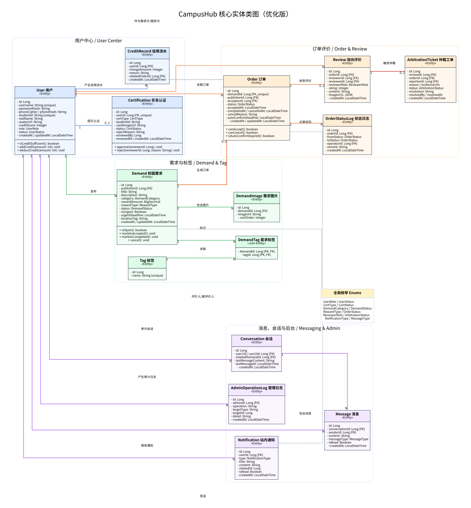
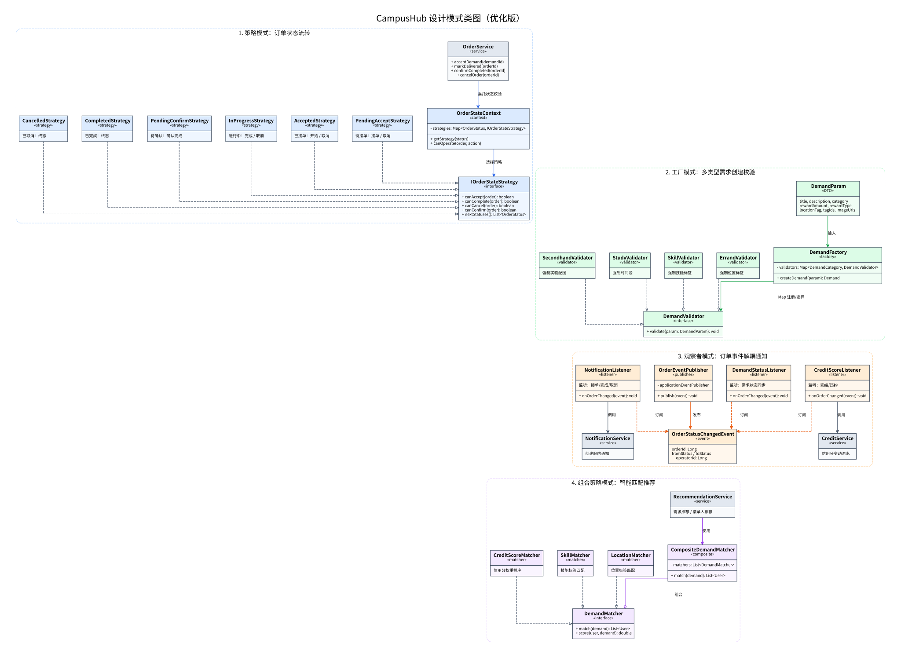
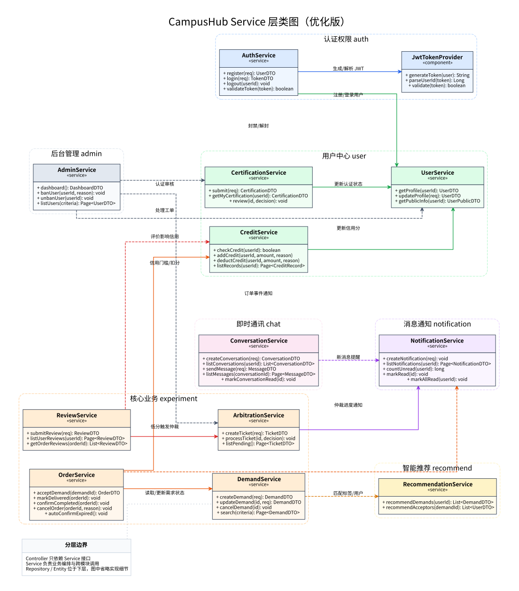
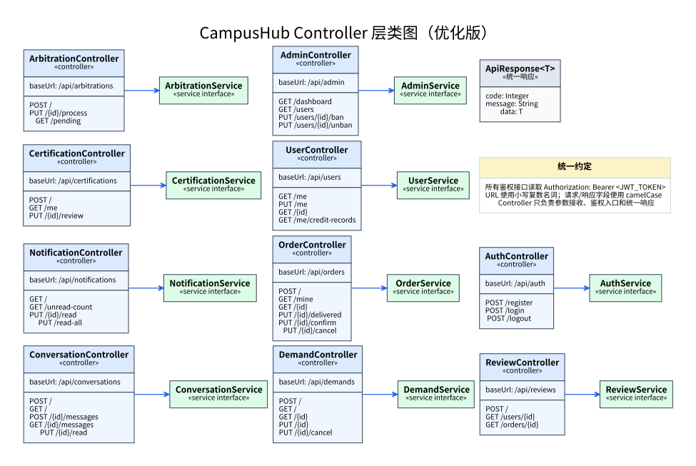

# CampusHub 核心类图（优化版）

> 说明：本版本主要优化图片的排版、配色、分组和线条可读性；类、接口、主要关系与原详细设计保持一致。

## 图 1 核心实体类图



源码文件：`source/class-diagram-entities.mmd`

## 图 2 系统设计模式类图



源码文件：`source/class-diagram-patterns.mmd`

## 图 3 Service 层类图



源码文件：`source/class-diagram-services.mmd`

## 图 4 Controller 层类图



源码文件：`source/class-diagram-controllers.mmd`

## 可读性优化说明

- 将原来横向过长的图拆成“实体 / 设计模式 / Service / Controller”四个视角，和原文档四类设计视图对应。
- 对同一业务域使用虚线分组：用户中心、需求与标签、订单评价、消息后台等。
- 统一字体、色块、边框、箭头和关系标签，避免大量交叉线造成阅读困难。
- 保留原有核心约束：1:0..1、1:N、1:0..2、N:M 等关系基数。
- 保留原有设计模式：订单状态策略、需求工厂、订单事件观察者、组合匹配策略。

